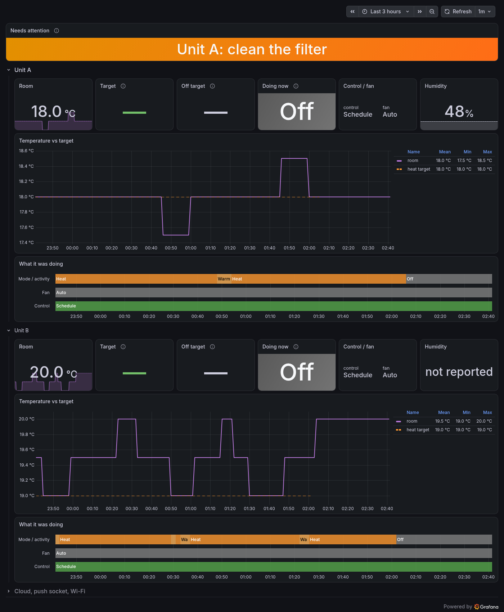

# comfortd

A small daemon for Mitsubishi Comfort (Kumo Cloud) air conditioners. It polls
the cloud, shows each unit in a web UI, exposes them to Apple Home, and sends
commands back.


## What it does

- **Web UI**: mode, setpoint, fan and vane for each unit, with live updates,
  the unit's schedule (viewable and editable), and a feed of changes.
- **HomeKit**: each unit is a HeaterCooler accessory, with Dry and Fan only
  switches.
- **API**: `GET /v1/units`, `GET /v1/units/{slug}/raw/{endpoint}`,
  `GET /v1/history`, `POST /v1/units/{slug}/command`.
- **Metrics**: `/metrics` serves each unit's state and the health (`comfortd_up`, last poll, endpoint errors, request and socket counters). With `--push name=url` (repeatable; VictoriaMetrics, or Prometheus with its receiver on) each unit's state is also pushed with remote write the moment it changes (from the push socket or a poll), so changes keep their real time and none fall between scrapes; a fresh unit whose state has not changed is resent each minute, a stale one shows as a gap. The pushed gauges on `/metrics` then carry `pushed_<name>="true"`, so the target's own scrape can drop its copies (`metric_relabel_configs: [{source_labels: [pushed_<name>], regex: "true", action: drop}]`); other scrapers keep them. Each target has its own queue (`comfortd_push_queued_samples{target}`, `comfortd_push_errors_total{target}`). With an importable Grafana dashboard in `grafana/comfortd.json` (unit names replaced):

  

Commands are checked against the unit's own limits (modes, fan speeds,
setpoint range) before they are sent.

Each unit's adapter Min/Max setpoints (the lowest cooling and highest heating
setpoint, as in the Comfort app) can also be set from its card.

The Kumo Cloud API is unofficial. What is known about it is in
[docs/api-inventory.md](docs/api-inventory.md).

## Try it

With Go installed, run it against the built-in fake cloud:

```sh
go run ./cmd/comfortd -fake -state-dir /tmp/comfortd-dev
```

Then open http://127.0.0.1:9879/.

## Run it for real

Put your Comfort login in a file: email on the first line, password on the
second. Then:

```sh
comfortd -credentials /path/to/credentials -state-dir /var/lib/comfortd \
  -homekit-units office,house
```

`comfortd -h` lists every flag. The main ones (listen address, state dir,
credentials, poll interval, and the unit lists) can also be set as
`COMFORTD_<FLAG>`, for example `COMFORTD_HOMEKIT_UNITS`.

### NixOS

The flake has a package and a NixOS module. Add it as an input and put the
module in your system's `modules` list:

```nix
# flake.nix
{
  inputs = {
    nixpkgs.url = "github:NixOS/nixpkgs/nixos-unstable";
    comfortd = {
      url = "github:hughobrien/comfortd";
      inputs.nixpkgs.follows = "nixpkgs";
    };
  };

  outputs = { nixpkgs, comfortd, ... }: {
    nixosConfigurations.myhost = nixpkgs.lib.nixosSystem {
      system = "x86_64-linux";
      modules = [
        comfortd.nixosModules.default # services.comfortd.package defaults to this flake's build
        ./configuration.nix
      ];
    };
  };
}
```

Then configure it, for example in `configuration.nix`:

```nix
{
  services.comfortd = {
    enable = true;
    credentialsFile = "/etc/comfortd/credentials";
    homekit = { enable = true; units = [ "office" "house" ]; port = 51830; };
    openFirewall = true;      # HomeKit port and mDNS (UDP 5353)
    prometheus.enable = true; # push to and be scraped by the local store
  };
  services.victoriametrics.enable = true;
  # Or Prometheus with the receiver on; set the flag once, even if several
  # exporters push: Prometheus refuses it twice.
  # services.prometheus.extraFlags = [ "--web.enable-remote-write-receiver" ];
}
```

The credentials file holds the Comfort account email on the first line and
the password on the second. systemd hands it to the service
(`LoadCredential`), so it can stay root-only:

```sh
sudo install -d -m 700 /etc/comfortd
sudo install -m 600 /dev/null /etc/comfortd/credentials
sudoedit /etc/comfortd/credentials
```

After `nixos-rebuild switch` the web UI is on port 9879. Unit slugs (for
`homekit.units` and `inactiveUnits`) are listed at `/v1/units`. The HomeKit
pairing code is shown at `/homekit`.

| Option | Default | |
|---|---|---|
| `listen` | `"127.0.0.1:9879"` | web UI, API and `/metrics` |
| `credentialsFile` | (required) | Comfort account file |
| `pollInterval`, `backstop` | `"60s"`, `"2m"` | Go durations |
| `homekit.enable`, `.units`, `.port` | `false`, `[ ]`, `0` | units to expose to HomeKit; port 0 picks one |
| `inactiveUnits` | `[ ]` | units shown as a blank placeholder in the web UI |
| `push.<name>.url` | `{ }` | more remote write targets; their hosts' scrapes should drop `pushed_<name>` |
| `prometheus.enable` | `false` | push to the local `services.victoriametrics` (else `services.prometheus`) and register a scrape job that drops what it was pushed; for Prometheus, asserts the receiver flag |
| `prometheus.pushName` | host name, `-` and `.` as `_` | the local target's name |
| `prometheus.url` | from the local store | where to push |
| `prometheus.jobName`, `.scrapeInterval` | `"comfortd"`, `"60s"` | the `job` label (scraped and pushed), scrape interval |
| `openFirewall` | `false` | open the HomeKit port and mDNS (UDP 5353); the web UI stays on `listen` |
| `extraArgs` | `[ ]` | extra command-line flags |

## Development

```sh
go test ./...
just gate   # the Nix build and tests, on a machine with Nix
```

## License

GPL-3.0-or-later.
