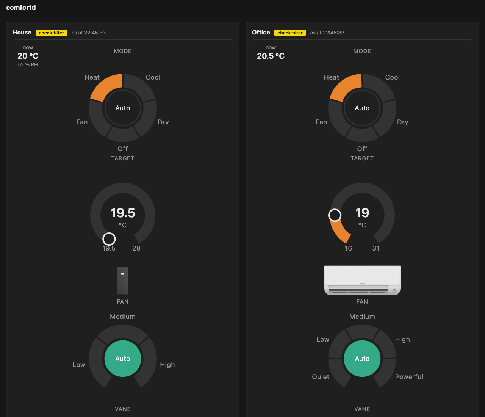

# comfortd

A small daemon for Mitsubishi Comfort (Kumo Cloud) air conditioners. It polls
the cloud, shows each unit in a web UI, exposes them to Apple Home, and sends
commands back.



## What it does

- **Web UI**: mode, setpoint, fan and vane for each unit, with live updates,
  the unit's schedule (viewable and editable), and a feed of changes.
- **HomeKit**: each unit is a HeaterCooler accessory, with Dry and Fan only
  switches.
- **API**: `GET /v1/units`, `GET /v1/units/{slug}/raw/{endpoint}`,
  `GET /v1/history`, `POST /v1/units/{slug}/command`.
- **Metrics**: Prometheus at `/metrics`.

Units are read-only unless you list them as writable. Commands are checked
against the unit's own limits (modes, fan speeds, setpoint range) before they
are sent.

The Kumo Cloud API is unofficial. What is known about it is in
[docs/api-inventory.md](docs/api-inventory.md).

## Try it

With Go installed, run it against the built-in fake cloud:

```sh
go run ./cmd/comfortd -fake -state-dir /tmp/comfortd-dev -writable-units office,house
```

Then open http://127.0.0.1:9879/.

## Run it for real

Put your Comfort login in a file: email on the first line, password on the
second. Then:

```sh
comfortd -credentials /path/to/credentials -state-dir /var/lib/comfortd \
  -writable-units office -homekit-units office,house
```

`comfortd -h` lists every flag. The main ones (listen address, state dir,
credentials, poll interval, and the unit lists) can also be set as
`COMFORTD_<FLAG>`, for example `COMFORTD_WRITABLE_UNITS`.

### NixOS

The flake provides a package and a module:

```nix
{
  inputs.comfortd.url = "git+https://forgejo.wg/hughobrien/comfortd";

  # in your configuration:
  imports = [ inputs.comfortd.nixosModules.default ];
  services.comfortd = {
    enable = true;
    package = inputs.comfortd.packages.${pkgs.system}.default;
    credentialsFile = "/persist/comfortd/credentials";
    writableUnits = [ "office" ];
    homekit = { enable = true; units = [ "office" "house" ]; port = 51830; };
    openFirewall = true;
  };
}
```

The HomeKit pairing code is shown at `/homekit`.

## Development

```sh
go test ./...
just gate   # the Nix build and tests, on a machine with Nix
```

## License

GPL-3.0-or-later.
